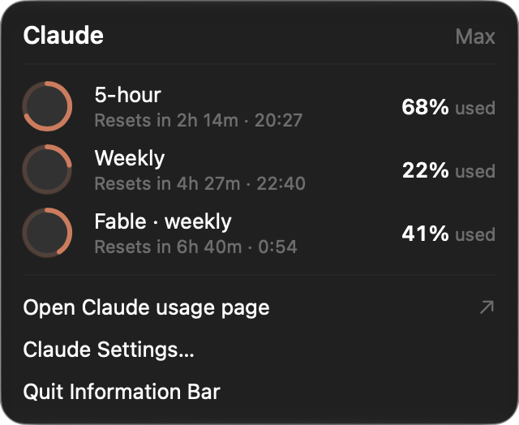
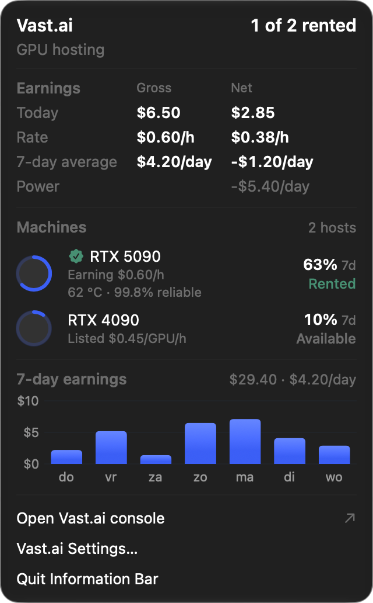
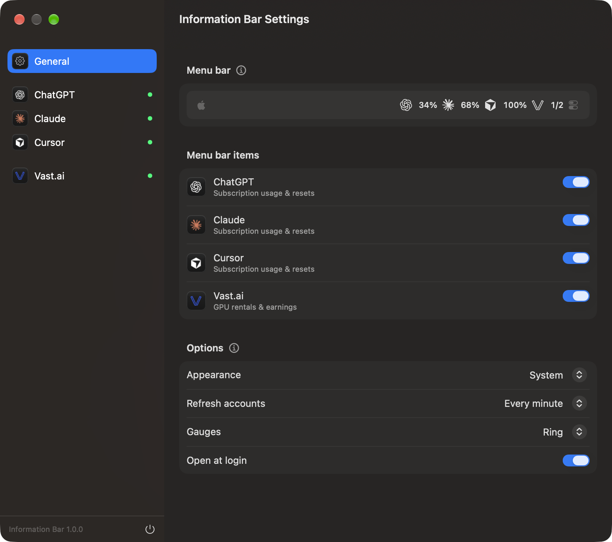

# Information Bar

Menu bar usage for ChatGPT, Claude and Cursor, Vast.ai rentals, Pearl mining, your Kraken portfolio and HomeWizard power. Native macOS; settings and normalized metrics stay on your Mac.

<p>
  
  
</p>


## What it shows

- ChatGPT, Claude and Cursor: every allowance pool with usage and reset time, including per-model weekly limits such as Claude's Fable cap.
- Vast.ai: rented machines with utilization, earnings today, hourly rate, a 7-day chart, and net figures after your power cost, in USD or EUR.
- Pearl: live PRL price, Kryptex pool hashrate, confirmed wallet balance, unpaid rewards with progress to the payout threshold, recent payouts, and hourly, daily, weekly and 30-day monthly revenue/profit projections. The bar shows the 30-minute accepted hashrate; the dropdown also shows 3-hour and 24-hour averages. Wallet balance, unpaid rewards, total paid and each profit period are available as menu bar items.
- Kraken: spot balances with each asset's last Kraken trade price, today's change and value, plus the portfolio total in USD or EUR. Staked and Earn balances count toward their asset. Portfolio value, today's change and the price of any held asset are available as menu bar items.
- Power: independent electricity tariff, HomeWizard device discovery (v1 and v2), measured draw and projected costs. Assign meters to Pearl or Vast.ai, or monitor a whole-house meter separately. Existing Vast.ai tariffs migrate automatically.
- Menu bar items you compose yourself per provider: icon, values, rings and a 7-day graph, as in iStat Menus.

## Install

Requires macOS 27, Python 3, and the signed-in Codex CLI, Claude Code and Cursor app. The Vast.ai API key is entered in Settings and kept in Keychain.

For Pearl, enter your public PRL mining wallet address under **Settings → Pearl**, and optionally a worker name (leave it empty for all workers). Hashrate, unpaid rewards and payouts come directly from Kryptex; confirmed wallet balance comes from Pearl's public mainnet explorer. No local stats server or miner API is needed. PRL price comes from CoinGecko's `pearl-2` asset, and yield/pool fees come from Kryptex. See the [pool setup and projection guide](docs/pearl-pool.md).

For Kraken, create an API key in Kraken Pro under [Settings → API](https://pro.kraken.com/app/settings/api) with only the **Query Funds** permission, then paste the API key and private key under **Settings → Kraken**. Save & connect checks them with one balance request and stores both in Keychain. Use the key only for Information Bar. See [Kraken in the data sources](docs/data-sources.md#kraken).

Under **Settings → Power**, set the electricity tariff and choose **Search for devices**. Select **Set up…** on a discovered meter to review its prefilled details and assign it to mining/hosting or monitoring only. Allow Local Network access when macOS asks. Search uses HomeWizard's Bonjour advertisements on your local network; **Add by address…** is available for other reachable networks. Enable Local API on v1 devices; v2 requires an API token (kept in Keychain). Power costs use assigned meter readings only; old manual wattages are ignored. Unavailable power or price leaves profit blank.

```sh
bash scripts/install-app.sh   # builds, installs in /Applications and opens the app
```

`bash scripts/build-app.sh` builds `dist/Information Bar.app` without installing. The build is ad-hoc signed for local use.

## How it works

A Python collector reads each provider's existing login, calls its usage endpoint and writes normalized metrics to a private cache. Tokens go only to their own provider; nothing else leaves your Mac. Endpoints, definitions and refresh rules: [docs/data-sources.md](docs/data-sources.md).

## Develop

```sh
python3 -m unittest discover -s tests -v   # collector
swift test                                  # app models
bash scripts/render-views.sh                # light and dark renders of every view
bash scripts/screenshots.sh                 # README screenshots from the app in demo mode
```

`--demo` runs the app on synthetic data; `--settings` and `--panel <provider>` open a window at launch. Providers include `pearl`, `kraken` and `power`.

## License

MIT. Provider marks are trademarks of their owners; see [assets/providers/README.md](assets/providers/README.md).
